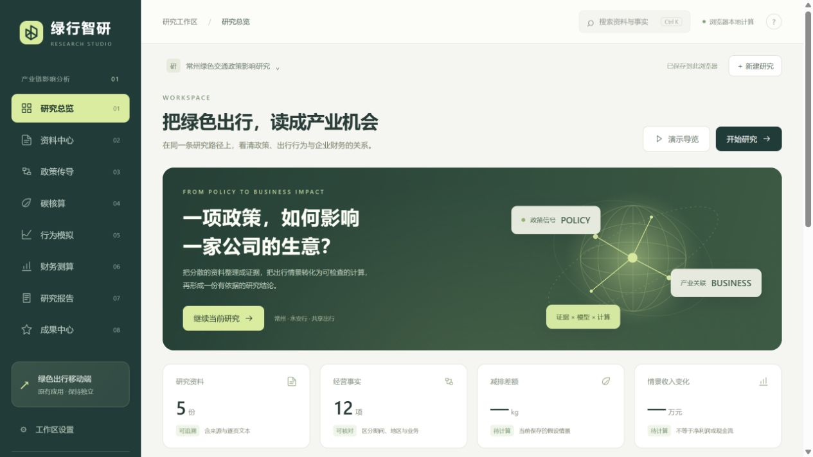

# 绿行智研 · Lvxing Research Studio

### 1.2 访问流程更新

新增产品首页、案例来源卡片、可跳过的个人工作区设置与加载过渡。比赛现场点击“跳过，直接体验”，或直接访问 `#overview`，即可进入工作台。展示信息仅保存于当前浏览器，不注册云端账号，不收集密码。现有研究底稿和导出流程保持不变。

新增入口模块：`dist/portal.mjs`、`dist/portal.css`。支持桌面与移动宽度，并响应系统“减少动态效果”设置。

面向绿色交通产业研究的中文桌面工作台。把政策资料、事实核对、碳核算、行为情景和财务测算串成一条可操作的研究流程，并导出可复核的研究底稿。

**[直接打开在线平台](https://lizexuan581-stack.github.io/lvxing-research-studio/)** · 无需登录或安装，电脑浏览器体验最佳。

本仓库提供可运行的浏览器前端，不需要账户、API Key 或后端服务。当前版本是本地研究工具，**尚未接入外部大语言模型、OCR、实时行情或多人云端协作**。



## 快速运行

不需要下载源码时，直接使用上方在线平台。以下步骤用于本地运行与二次开发。

安装 Node.js 22 或更高版本，在仓库目录执行：

```bash
npm start
```

打开 http://127.0.0.1:8780/ 。不需要执行 `npm install`，也没有构建步骤。不要直接双击 `dist/index.html`：PDF Worker 需要 HTTP 服务。

已有 Python 3 的用户也可以执行：

```bash
python -m http.server 8780 --bind 127.0.0.1 --directory dist
```

## 产品功能

| 模块 | 可以完成什么 |
| --- | --- |
| 研究总览 | 创建、切换研究项目，查看研究进度与计算记录 |
| 资料中心 | 导入文字型 PDF、TXT、MD、CSV、JSON；逐页检索、人工核对、分类与导出事实表 |
| 政策传导 | 限定业务与期间，填写政策六要素、作用路径、关联来源与证据缺口 |
| 碳核算 | 计算排放差额，逐项展示替代方式的贡献，导入和导出 CSV |
| 行为模拟 | 调整收益差参数；按人群、频次、覆盖、供给及承接拆分收费与免费订单 |
| 财务测算 | 补偿核验、固定费用与现金激励、敏感性；历史同比/毛利/量价复算；保存12个对比情景 |
| 研究报告 | 跟踪条件、反向证据、报告过期检查；导出 Markdown、HTML、研究包、manifest与JSONL日志 |
| 成果中心 | 查看公开研究参考、交付入口与开源范围，并运行 42 项页面内功能检查 |

建议首次使用顺序：资料中心 → 政策传导 → 碳核算 → 行为模拟 → 财务测算 → 研究报告。

1.1版保留原工作区，增加城市线稿、流动路径、分层背景、图表入场效果；支持暂停动态和系统减少动态效果偏好。数据仍只保存在浏览器中。详见[本版变更与验收记录](docs/RELEASE_1.1.md)。

## 算法与示例

### 碳核算

`减排差额 = Σ[出行次数 × 里程 × (基准排放因子 − 情景排放因子)]`

内置两行演示参数的计算结果是 `78.80 kg CO₂e`。排放因子是演示假设，不是认证值；需要使用者替换成适用于其研究口径的依据。不等同于核证减排量，也不用于直接签发碳资产。

### 行为情景

采用固定收益差的单群体复制动态解析解：`dx/dt = k × x × (1 − x) × ΔU`。

收益差包含激励、费用节省、假设碳价值、时间成本与舒适性损失。演化轮次不是实际天数；没有城市样本校准，不能把结果直接当作真实订单预测。行为比例与订单之间的映射需要另行设置显式假设。

### 财务测算

金额使用整数分值引擎计算。以新增 30 万笔付费订单、每笔 2.16 元、边际成本每笔 1 元为演示假设，收入变化为 64.80 万元，边际经营贡献为 34.80 万元。

若再设定新增固定经营支出4万元、企业另行承担现金激励2万元，经营贡献降至28.80万元，盈亏平衡单价升至1.20元/笔。已包含在实收价中的优惠不重复扣费。上述新增费用的零值表示本次未计入，不证明实际不存在费用。

历史工具保留输入披露值，分别计算收入同比、毛利、毛利率、业务占比和量价效应。前期收入为零时不显示同比；缺订单或单价时不生成量价结果。以万元披露值计算可能与元级底稿有尾差；桥接残差单独展示，不强行凑平。

同样的 30 万笔若全部免费、没有有效补偿依据，收入为 0，经营贡献为 −30 万元。免费使用量不能自动记成收入；经营贡献也不是净利润。所有情景仅用于方法展示，不构成投资建议。

## 资料与数据

内置常州—永安行案例含 5 份公开资料摘编和 12 个事实字段，并保留来源链接、时期及页码。摘编不是原始全文；研究前请打开原文复核，或自行导入获得使用权的原文件。财报数据、政策目标和情景假设分别展示，不应混用。

PDF 支持文字型文档，单个文件最大 25 MB / 300 页。扫描件需要先做 OCR；复杂表格和数值候选句均需要人工复核。

## 本地数据与隐私

项目和导入文本保存在当前浏览器、当前站点的 IndexedDB 中。当前应用代码不把导入资料发送到服务器；没有远程数据库、遥测或分析 SDK。访问外部来源或移动端链接时会打开相应第三方网站。

换浏览器、换域名或清理站点数据不会自动迁移项目，请先导出工作区备份。若自行部署到互联网，用户数据仍按浏览器独立保存；这并不等同于具有权限管理的企业系统。不建议导入机密文件。

在线平台通过 GitHub Pages 托管公开静态文件，不需要登录 GitHub 或 ChatGPT。你在某个浏览器内创建的研究不会自动共享给其他访客。由私有版切换到公开网址时，需要自行导出、导入工作区备份。

## 网站部署

`.github/workflows/pages.yml` 在 `main` 更新后先运行测试，再只发布 `dist/`。仓库设置中的 Pages 构建来源为 GitHub Actions。发布到独立项目路径，不会覆盖账号原有的个人主页。

## 测试

```bash
npm test
```

- `tests/core.test.cjs`：24 项内置规则测试，以及 10 项边界测试。
- `tests/research.test.cjs`：18 项新增内置规则测试，以及 21 项迁移、口径、导入与报告一致性检查。
- `tests/release.test.cjs`：公开包资源、许可证、脚本语法及案例页码检查。
- 合计73项规则及边界检查，另有发布包检查。成果中心可现场运行其中42项计算规则检查。

这些是代码与规则测试，不是大模型准确率、预测准确率或真实减排效果评测。

## 目录

```text
dist/
  index.html          页面入口
  app.js              页面交互、存储、资料导入、导出
  core.js             碳核算、行为模型、搜索及报告
  finance-engine.js   确定性金额引擎
  data.js             案例资料和演示参数
  research.js         历史复算、分层映射、迁移与报告输入快照
  studio-v2.mjs       扩展交互与模块编排
  studio-v2.css       分层背景、动效、响应式与减少动态效果
  style.css           视觉样式
  vendor/             PDF.js、字体、字符映射及 WASM
scripts/serve.cjs      仅绑定本机的静态服务器
tests/                可复现测试
docs/                 开源范围与第三方声明
```

## 开源范围与许可

自有代码与自有技术文档使用 [MIT License](LICENSE)。第三方组件保留原许可证，详见 [第三方声明](THIRD_PARTY_NOTICES.md)。

本仓库不包含移动端源码、生产数据库、个人证书、专利受理通知原件、论文全文、录音、参赛计划书或私有部署配置。仓库之外的作品不因本次发布被重新许可。关于范围和使用边界，见 [公开版说明](docs/PUBLIC_RELEASE.md)。

研究参考：[Mathematics 2026, 14(2), 348](https://doi.org/10.3390/math14020348)。本版简化模型不代表对论文全部模型的复现或实证验证。

欢迎提交问题和改进建议。请勿在 Issue、Pull Request 或示例文件中上传密钥、个人信息或无权公开的原始资料。
